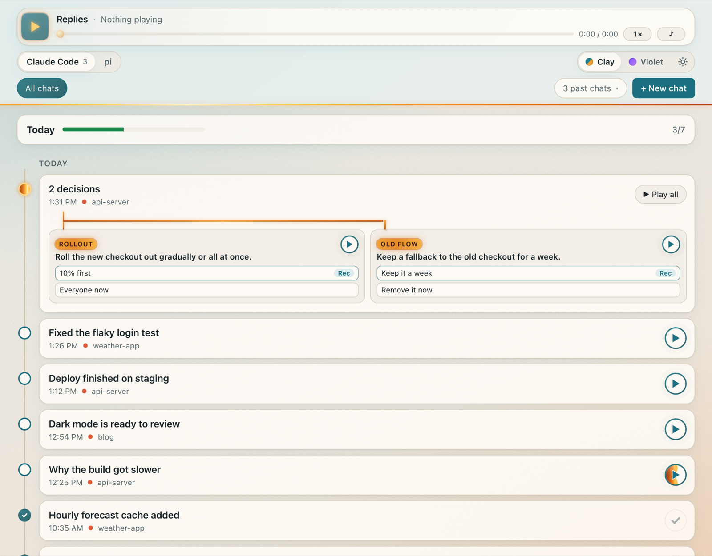
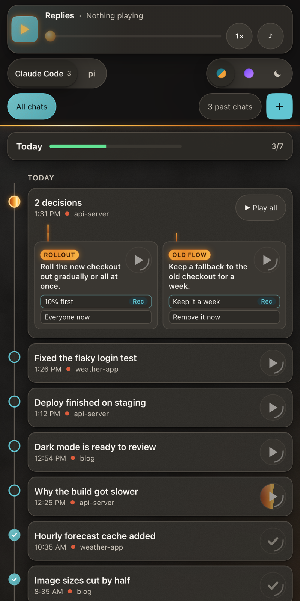
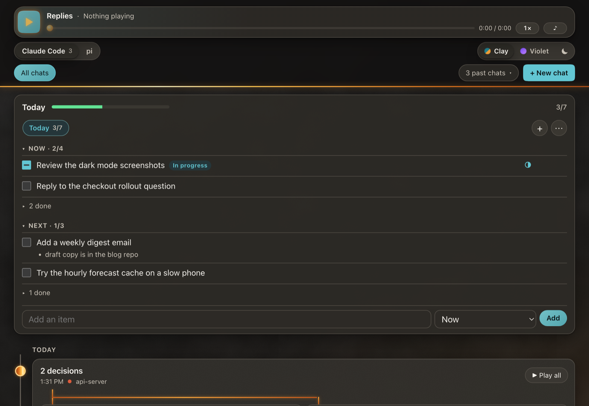

# replies

**Spoken replies for Claude Code.** Every longer reply from Claude becomes a short audio clip on
a private web page on your Mac. Questions Claude asks show up as cards you can answer with a tap.
Answer by typing or talking, from your Mac or your phone.



- **Listen instead of read:** each reply is rewritten as a 30 to 90 second spoken summary, voiced on your Mac.
- **Answer from anywhere:** tap an option on a question card, type, or tap the mic and talk. Your answer is typed into the chat for you.
- **Phone access** over your own [Tailscale](https://tailscale.com) network. Nothing is put on the public internet.
- **A to-do list** above the feed that Claude can keep up to date from your chats.

## Install

You need a Mac with [Claude Code](https://claude.com/claude-code). In a terminal:

```sh
claude plugin install replies --marketplace dillonkermani/replies
```

Then restart Claude Code and run `/replies-setup`. It checks your Mac, asks before installing
anything (ffmpeg, whisper.cpp, tmux), connects your phone, and ends with a spoken test reply.
After that, `/replies` opens the page on the chat you're in.

**Get updates automatically:** run `/plugin`, open **Marketplaces**, pick **replies** and choose
**Enable auto-update**. A running page switches to a new version by itself.

## Phone

`/replies-setup` walks you through it. In short: install Tailscale on the Mac and the phone,
signed in to the same account; turn on **MagicDNS** and **HTTPS Certificates** in the
[Tailscale admin](https://login.tailscale.com/admin/dns); then open the phone link the setup
prints. On an iPhone, turn off iCloud **Private Relay**, or the link won't open.

To reply from the page, the chat has to run inside tmux: `tmux new -s claude claude`. A message
waits until Claude's prompt is empty, and closes an open question only when it answers that question.

<p>
  
  
</p>

## Privacy

- Speech is made on your Mac (a local [Kokoro](https://github.com/remsky/Kokoro-FastAPI) server if you run one, otherwise macOS's own voice). Reply text never goes to a cloud voice service.
- Speech-to-text runs on your Mac with whisper.cpp; the browser's speech recognition isn't used.
- The spoken summary is written by Claude through your own `claude` CLI, so reply text goes to Anthropic like the rest of your session.
- The page answers only on `localhost`, every request needs your install's secret key (the `#k=` part of your link), and the phone link works only through your own tailnet. Don't post your links.

## Settings

`claude plugin configure replies@replies`

| Option | Default | What it does |
|---|---|---|
| `model` | `claude-sonnet-5-5` | writes the spoken summary of each longer reply, on your Claude account |
| `port` | `8799` | local page port; the phone listener uses the port below it |
| `phone` | `on` | `off` skips the Tailscale link |
| `install_deps` | `off` | `on` installs the helpers in the background instead of asking |

## Uninstall

```sh
claude plugin uninstall replies@replies
tailscale serve --https=8443 off
```

The page server stops by itself within a minute once the plugin is gone.

## License

[MIT](LICENSE)
